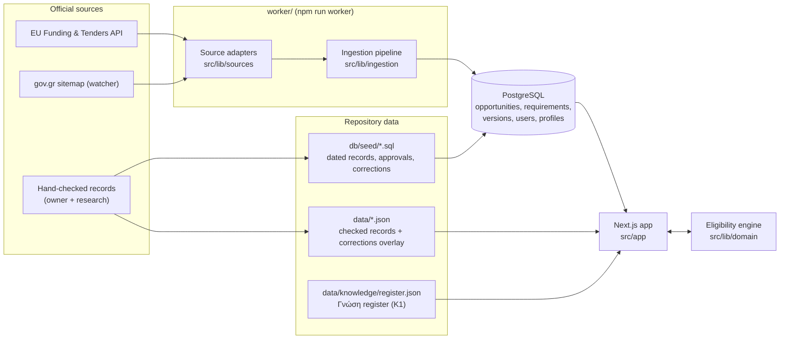

# 02 — Architecture

One Next.js application, one PostgreSQL database, one background worker. No other services are required; AI
extraction and email are built or prepared but switched off.

## Parts

| Part | Where | What it does |
| --- | --- | --- |
| Web app | `src/app` (App Router), `src/components` | Pages for both paths, Γνώση, account, admin; server components read the database directly |
| Site logic | `src/lib/site` | Copy (EL/EN), the two paths, listing and detail presentation, guides, the record overlay |
| Eligibility engine | `src/lib/domain` | Pure, deterministic matching of a profile against structured requirements |
| Data access | `src/lib/data`, `src/lib/db` | SQL queries (the `postgres` library, no ORM) |
| Auth | `src/lib/auth`, `src/proxy.ts` | Sessions, roles, login rate limit, optional site password |
| Sources | `src/lib/sources` | The EU Funding & Tenders adapter (search + details) and the gov.gr sitemap watcher |
| Ingestion | `src/lib/ingestion` | Idempotent, versioned import; status and deadline sweep; match recalculation |
| AI extraction | `src/lib/ai` | Proposes requirements from a call document into a human review queue; off by default |
| Γνώση | `src/lib/knowledge`, `src/app/gnosi` | Register, publication gate, search; a universal section outside the two paths |
| Worker | `worker/index.ts` | Runs the sources on schedule, sweeps deadlines, applies data retention, writes heartbeats |
| Scripts | `scripts/` | Migrations, seeds, importers, record generators, screenshots, preview copy, quality report |

## Principles the code enforces (do not weaken)

1. **Unknown is never positive.** A missing answer gives «unknown», never a pass (see [05](05-eligibility-engine.md)).
2. **Every displayed fact has a source.** Records carry official URL, check date, original wording and
   uncertainties; disputed facts are shown as disputed.
3. **Only confirmed application periods are «open».** Unconfirmed future periods are shown as conditional, and the
   apply button is hidden whenever availability is unverified, conflicting, closed or suspended.
4. **One path per programme.** Each programme, news item and guide belongs to exactly one path; pages never mix them
   (`src/lib/site/audience.ts`, tested by `tests/audience.test.ts` and a browser check).
5. **Nothing unverified is public in Γνώση.** Only entries passing `publicationGate` appear outside the private preview.
6. **Relevance never changes eligibility.** Interests, industries and personas only choose questions and order.

## Two sources of truth for hand-checked records (important)

The hand-checked programme records live in the database (inserted by dated seed files) **and** in
`data/official-records-2026-10-14.v2.json` plus `data/official-records-corrections-2026-10-22.json`, which
`src/lib/site/checked-records.ts` merges and the pages read through `src/lib/site/verified.ts`. The JSON holds the
evidence the database does not model (per-year deadline rules, conflicts, application steps, evidence excerpts). A
correction must be made in the JSON **and** reflected in a seed; `scripts/build_corrections_2026_10_23.py`
generates the 23 Oct seed from the JSON for this reason. Replacing this with one admin-managed store is the largest
technical item in the backlog.

## Languages

Greek is the default; English is a full translation, switched by a cookie. Page copy is in `src/lib/site/copy.ts`
(the site) and `src/lib/i18n/dictionaries.ts` (older shared strings). Official titles stay in their original
language with a translation where one has been checked.
